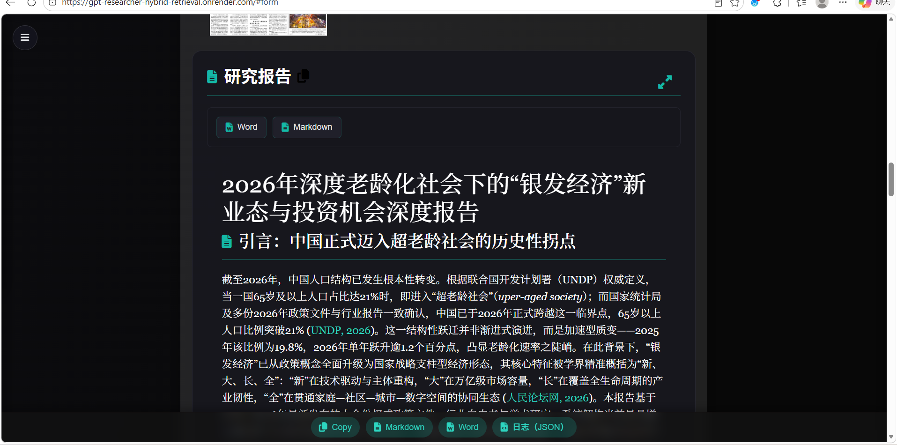
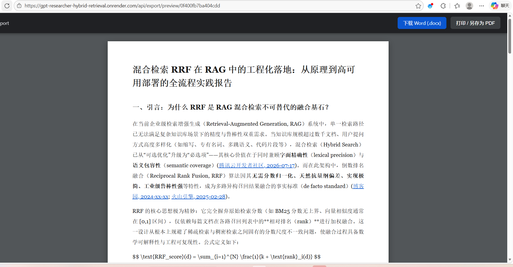
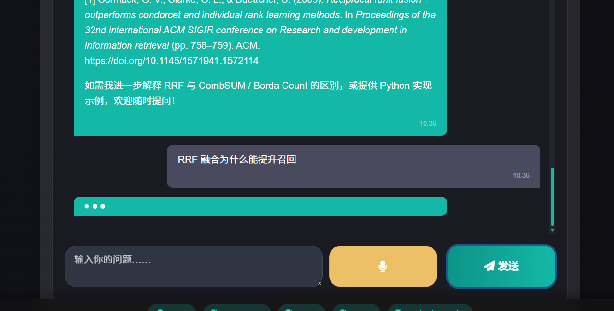

> **Fork of [assafelovic/gpt-researcher](https://github.com/assafelovic/gpt-researcher).**
> 本仓库在其基础上重构了 RAG 检索链路：数据清洗 → BM25 + 向量双路召回 → 手写 RRF 融合 → 重排截断。
> 评测方法与结果见 [EVAL.md](EVAL.md)，**一页纸项目说明见 [docs/PROJECT.md](docs/PROJECT.md)**。

## 🚀 在线 Demo

**https://gpt-researcher-hybrid-retrieval.onrender.com**

> Render 免费实例：首次访问约 50 秒冷启动；PDF / Word 首次生成需 1~3 分钟（0.1 核 CPU 渲染），之后直接命中缓存。

界面为中文。左侧会话栏可**新建 / 切换 / 删除**对话，切回旧对话可继续追问；报告支持复制、Markdown、JSON 日志、Word 预览（预览页可另存为 PDF）。

### 界面预览

研究报告与导出（左上角 ☰ 是会话侧边栏，底栏为四项导出）：



Word 预览页（浏览器不能原生渲染 `.docx`，所以把同一份正文渲染成排版好的网页，顶部提供下载原件与打印存 PDF）：



针对报告继续追问（回答会带上该会话的报告正文与历史）：



---

## 与上游的差异

| 模块 | 上游 | 本二创 |
|---|---|---|
| 抓取后清洗 | 简单去噪 | `scraper/cleaning.py`：模板行过滤、跨页重复检测、元信息块裁剪、分块去重 |
| 召回 | 单一向量或 keyword | **BM25（jieba 分词）+ 向量**双路召回，`context/hybrid.py` |
| 融合 | 无 | **手写 RRF `1/(60+rank)`**，不做分数归一化 |
| 重排 | 无 | `context/rerank.py`：Top20 → qwen3-rerank → **Top3** 送入模型 |
| 评测 | 无 | `eval_context.py` 固定语料回放，语义覆盖率 + 预算对齐 |
| 前端 | 英文静态页 + Next.js | 中文静态页 + 会话侧边栏 |
| 部署 | 需自行配置 | Render 一键部署 + 精简 Dockerfile |

## 检索链路

```
搜索 → 抓取网页 → 清洗去重（cleaning.py）
                      │
         ┌────────────┴────────────┐
         ▼                         ▼
   BM25 召回                  向量召回
 (jieba 中文分词)        (text-embedding-v4, 1024 维)
         └────────────┬────────────┘
                      ▼
             RRF 融合  1/(60+rank)
                      ▼
         重排 qwen3-rerank → Top3
                      ▼
              拼入 Prompt → 写作
```

设计要点：

- **为什么用 RRF 而不是加权分数**：BM25 分数无上界，余弦相似度在 [-1,1]，量纲不同、分布不同，直接加权需要归一化和调参，跨查询不稳定；RRF 只用名次，天然免疫量纲问题。
- **k=60 的含义**：抑制头部权重，让第 1 名和第 2 名的差距不至于压倒长尾，是业界常用默认值。
- **为什么不引入 faiss / chroma 做持久索引**：单次研究的候选块只有几十到几百，内存里算 BM25 与余弦足够；引入向量库会增加部署体积和延迟，收益在这个量级下不明显。

## 评测结果

固定语料回放（同一批网页，只改排序策略），5 个查询平均，预算对齐 2000 字符：

| 模式 | 平均字符 | 语义覆盖 | 平均耗时 |
|---|---|---|---|
| none（全量塞入） | 25492 | 0.712 | — |
| keyword（上游默认） | 9937 | 0.733 | 0.21s |
| embeddings | 10001 | 0.742 | 15.16s |
| hybrid | 1721 | 0.755 | 1.86s |
| **hybrid + rerank** | **1703** | **0.764** | 2.56s |

上下文压缩 **93%**（25492 → 1703 字符），语义覆盖 0.712 → 0.764，5 个查询上均不低于上游 keyword。

> 诚实说明：重排相对 hybrid 仅 **+0.009**（2/5 略优、3/5 持平），样本量小，只能说方向正确、幅度有限；候选池仅 20~85 块时 RRF 已经足够好，重排的价值需要更大候选池才能体现。

## 部署（Render 免费层）

- Runtime：Docker（根目录 `Dockerfile`，含 pango / CJK 字体，去掉浏览器）
- 环境变量：

```
OPENAI_API_KEY=...
OPENAI_BASE_URL=https://dashscope.aliyuncs.com/compatible-mode/v1
FAST_LLM=openai:qwen-flash
SMART_LLM=openai:qwen-plus
STRATEGIC_LLM=openai:qwen-max
TAVILY_API_KEY=...
RETRIEVER=tavily
EMBEDDING=custom:text-embedding-v4
CONTEXT_FILTER=hybrid
RERANK_BACKEND=dashscope
RERANK_TOP_K=3
LANGUAGE=chinese
```

> ⚠️ **不要设置 `WEB_PROXY`**：云端容器访问不到你本机的代理，设了会导致所有抓取失败。

## 已知限制

- **PDF 慢**：WeasyPrint 在 0.1 核免费实例上渲染中文长报告需 1~3 分钟；已改为「点击时按需生成 + 轮询进度」，不会阻塞界面。
- **会话持久化**：主存浏览器 `localStorage`，另存服务端 `data/sessions.json`；免费层无持久磁盘，重新部署会清空服务端那份（浏览器里的不受影响）。
- **评测样本小**：仅 5 个查询，用于看趋势，不足以做显著性结论。
- **上游 CI 的 `imports` 作业**：`gpt_researcher/utils/logger.py` 顶层 `import click`，但上游 `requirements.txt` 未声明，`setup.py` 又排除了 `uvicorn`（本机靠它顺带装上 click），属上游遗留问题，与本二创无关。

---

<div align="center" id="top">


####

[](https://gptr.dev)
[](https://docs.gptr.dev)
[](https://discord.gg/QgZXvJAccX)


[](https://badge.fury.io/py/gpt-researcher)

[](https://colab.research.google.com/github/assafelovic/gpt-researcher/blob/master/docs/docs/examples/pip-run.ipynb)
[](https://hub.docker.com/r/gptresearcher/gpt-researcher)
[](https://skills.sh/assafelovic/gpt-researcher/gpt-researcher)
[](https://twitter.com/assaf_elovic)

[English](README.md) | [中文](README-zh_CN.md) | [日本語](README-ja_JP.md) | [한국어](README-ko_KR.md) | [Русский](README-ru_RU.md)

</div>

# 🔎 GPT Researcher

**GPT Researcher the first open deep research agent designed for both web and local research on any given task.** 

The agent produces detailed, factual, and unbiased research reports with citations. GPT Researcher provides a full suite of customization options to create tailor made and domain specific research agents. GPT Researcher goes well beyond RAG: planner and execution agents break each task into research questions, [decision models](#-smart-context-filtering-with-jev) keep only the context that is actually useful for answering them, [multi-agent](#-multi-agent-assistant) workflows coordinate specialized agents from planning to publication, and [recursive deep research](#-deep-research) explores a topic in both breadth and depth. Research runs in parallel, which keeps it fast, stable and reliable, and reduces misinformation.

**Our mission is to empower individuals and organizations with accurate, unbiased, and factual information through AI.**

## Why GPT Researcher?

- Objective conclusions for manual research can take weeks, requiring vast resources and time.
- LLMs trained on outdated information can hallucinate, becoming irrelevant for current research tasks.
- Current LLMs have token limitations, insufficient for generating long research reports.
- Limited web sources in existing services lead to misinformation and shallow results.
- Selective web sources can introduce bias into research tasks.

## Demo（上游原版界面）

> 下面是**上游原项目**的演示视频，用的是英文 Next.js 界面。
> 本二创的界面是中文静态版（带会话侧边栏），请在页面顶部的在线 Demo 里体验。

<a href="https://www.youtube.com/watch?v=f60rlc_QCxE" target="_blank" rel="noopener">
  
</a>

## Install as Claude Skill

Extend Claude's deep research capabilities by installing GPT Researcher as a [Claude Skill](https://skills.sh/assafelovic/gpt-researcher/gpt-researcher):

```bash
npx skills add assafelovic/gpt-researcher
```

Once installed, Claude can leverage GPT Researcher's deep research capabilities directly within your conversations.

## Architecture

The core idea is to utilize 'planner' and 'execution' agents. The planner generates research questions, while the execution agents gather relevant information. The publisher then aggregates all findings into a comprehensive report.

<div align="center">

</div>

Steps:
* Create a task-specific agent based on a research query.
* Generate questions that collectively form an objective opinion on the task.
* Use a crawler agent for gathering information for each question.
* Summarize and source-track each resource.
* Filter and aggregate summaries into a final research report.

## Tutorials
 - [How it Works](https://docs.gptr.dev/blog/building-gpt-researcher)
 - [How to Install](https://www.loom.com/share/04ebffb6ed2a4520a27c3e3addcdde20?sid=da1848e8-b1f1-42d1-93c3-5b0b9c3b24ea)
 - [Live Demo](https://www.loom.com/share/6a3385db4e8747a1913dd85a7834846f?sid=a740fd5b-2aa3-457e-8fb7-86976f59f9b8)

## Features

- 📝 Generate detailed research reports using web and local documents.
- 🖼️ Smart image scraping and filtering for reports.
- 🍌 **AI-generated inline images** using Google Gemini (Nano Banana) for visual illustrations.
- 📜 Generate detailed reports exceeding 2,000 words.
- 🌐 Aggregate over 20 sources for objective conclusions.
- 🎯 Smart context filtering with [Jev](#-smart-context-filtering-with-jev), with no API key or embeddings required by default.
- 🖥️ Frontend available in lightweight (HTML/CSS/JS) and production-ready (NextJS + Tailwind) versions.
- 🔍 JavaScript-enabled web scraping.
- 📂 Maintains memory and context throughout research.
- 📄 Export reports to PDF, Word, and other formats.

## 📖 Documentation

See the [Documentation](https://docs.gptr.dev/docs/gpt-researcher/getting-started) for:
- Installation and setup guides
- Configuration and customization options
- How-To examples
- Full API references

## ⚙️ Getting Started

### Installation

1. Install Python 3.12 or later. [Guide](https://www.tutorialsteacher.com/python/install-python).
2. Clone the project and navigate to the directory:

    ```bash
    git clone https://github.com/assafelovic/gpt-researcher.git
    cd gpt-researcher
    ```

3. Set up API keys by exporting them or storing them in a `.env` file.

    ```bash
    export OPENAI_API_KEY={Your OpenAI API Key here}
    export TAVILY_API_KEY={Your Tavily API Key here}
    ```

    (Optional) For enhanced tracing and observability, you can also set:
    
    ```bash
    # export LANGCHAIN_TRACING_V2=true
    # export LANGCHAIN_API_KEY={Your LangChain API Key here}
    ```

    For custom OpenAI-compatible APIs (e.g., local models, other providers), you can also set:
    
    ```bash
    export OPENAI_BASE_URL={Your custom API base URL here}
    ```

4. Install dependencies and start the server:

    ```bash
    pip install -r requirements.txt
    python -m uvicorn main:app --reload
    ```

Visit [http://localhost:8000](http://localhost:8000) to start.

For other setups (e.g., Poetry or virtual environments), check the [Getting Started page](https://docs.gptr.dev/docs/gpt-researcher/getting-started).

## Run as PIP package
```bash
pip install gpt-researcher

```
### Example Usage:
```python
...
from gpt_researcher import GPTResearcher

query = "why is Nvidia stock going up?"
researcher = GPTResearcher(query=query)
# Conduct research on the given query
research_result = await researcher.conduct_research()
# Write the report
report = await researcher.write_report()
...
```

**For more examples and configurations, please refer to the [PIP documentation](https://docs.gptr.dev/docs/gpt-researcher/gptr/pip-package) page.**

### 🔧 MCP Client
GPT Researcher supports MCP integration to connect with specialized data sources like GitHub repositories, databases, and custom APIs. This enables research from data sources alongside web search.

```bash
export RETRIEVER=tavily,mcp  # Enable hybrid web + MCP research
```

```python
from gpt_researcher import GPTResearcher
import asyncio
import os

async def mcp_research_example():
    # Enable MCP with web search
    os.environ["RETRIEVER"] = "tavily,mcp"
    
    researcher = GPTResearcher(
        query="What are the top open source web research agents?",
        mcp_configs=[
            {
                "name": "github",
                "command": "npx",
                "args": ["-y", "@modelcontextprotocol/server-github"],
                "env": {"GITHUB_TOKEN": os.getenv("GITHUB_TOKEN")}
            }
        ]
    )
    
    research_result = await researcher.conduct_research()
    report = await researcher.write_report()
    return report
```

> For comprehensive MCP documentation and advanced examples, visit the [MCP Integration Guide](https://docs.gptr.dev/docs/gpt-researcher/retrievers/mcp-configs).

## 🍌 Inline Image Generation

GPT Researcher can automatically generate and embed AI-created illustrations in your research reports using Google's Gemini models (Nano Banana).

```bash
# Enable in your .env file
IMAGE_GENERATION_ENABLED=true
GOOGLE_API_KEY=your_google_api_key
IMAGE_GENERATION_MODEL=models/gemini-2.5-flash-image
```

When enabled, the system will:
1. Analyze your research context to identify visualization opportunities
2. Pre-generate 2-3 relevant images during the research phase
3. Embed them inline as the report is written

Images are generated with dark-mode styling that matches the GPT Researcher UI, featuring professional infographic aesthetics with teal accents.

[Learn more about Image Generation](https://docs.gptr.dev/docs/gpt-researcher/gptr/image_generation) in our documentation.

## ✨ Deep Research

GPT Researcher now includes Deep Research - an advanced recursive research workflow that explores topics with agentic depth and breadth. This feature employs a tree-like exploration pattern, diving deeper into subtopics while maintaining a comprehensive view of the research subject.

- 🌳 Tree-like exploration with configurable depth and breadth
- ⚡️ Concurrent processing for faster results
- 🤝 Smart context management across research branches
- ⏱️ Takes ~5 minutes per deep research
- 💰 Costs ~$0.4 per research (using `o3-mini` on "high" reasoning effort)

[Learn more about Deep Research](https://docs.gptr.dev/docs/gpt-researcher/gptr/deep_research) in our documentation.

## 🎯 Smart Context Filtering with Jev

Every research run scrapes dozens of pages, and only some of each page helps answer the question. Before anything reaches the LLM, GPT Researcher decides which passages to keep. By default it uses **[Jev](https://typesafe.ai/blog/introducing-system-one-models-and-jev)** by TypeSafe, a model that scores how useful each passage is for the question, rather than how similar its words or embedding are.

**Jev's context is 59% more relevant than embeddings, at the same cost** (73% of kept passages relevant vs 46%). We benchmarked every option on 28 research tasks, replaying the same scraped sources so that only the filter changed:

| Context filter | Relevant passages kept | Head-to-head vs embeddings | Filter time | Cost per report | Needs |
|---|---|---|---|---|---|
| **Jev** (default) | **73%** | **15 wins · 10 ties · 3 losses** | 1.7s | $0.115 | `TYPESAFE_API_KEY` |
| Keyword (fallback) | 51% | 14 wins · 8 ties · 6 losses | 0.02s | $0.116 | nothing |
| Embeddings | 46% | — | 1.0s | $0.117 | an embedding provider |
| No filter | — | 13 wins · 11 ties · 4 losses | — | $0.192 | nothing |

Writing the report takes ~45s whichever filter you use, so a run's total time moves only by the filter step. Passing every page unfiltered writes the broadest reports on open-ended questions, but costs 65% more.

**Nothing is required.** With a `TYPESAFE_API_KEY`, Jev is used. Without one, or if a Jev call fails, GPT Researcher falls back to keyword (BM25) ranking, which runs locally with no API key, model or embeddings. Embeddings remain available as an option.

```bash
export TYPESAFE_API_KEY=...   # use Jev (the default when a key is set)
export CONTEXT_FILTER=auto    # auto | jev | keyword | embeddings | none
```

See the [Context Filter docs](https://docs.gptr.dev/docs/gpt-researcher/gptr/context-filter) and the [full benchmark](evals/context_filter) for method, caveats and how to reproduce it.

## Run with Docker

> **Step 1** - [Install Docker](https://docs.gptr.dev/docs/gpt-researcher/getting-started/getting-started-with-docker)

> **Step 2** - Clone the '.env.example' file, add your API Keys to the cloned file and save the file as '.env'

> **Step 3** - Within the docker-compose file comment out services that you don't want to run with Docker.

```bash
docker-compose up --build
```

If that doesn't work, try running it without the dash:
```bash
docker compose up --build
```

> **Step 4** - By default, if you haven't uncommented anything in your docker-compose file, this flow will start 2 processes:
 - the Python server running on localhost:8000<br>
 - the React app running on localhost:3000<br>

Visit localhost:3000 on any browser and enjoy researching!


## 📄 Research on Local Documents

You can instruct the GPT Researcher to run research tasks based on your local documents. Currently supported file formats are: PDF, plain text, CSV, Excel, Markdown, PowerPoint, and Word documents.

Step 1: Add the env variable `DOC_PATH` pointing to the folder where your documents are located.

```bash
export DOC_PATH="./my-docs"
```

Step 2: 
 - If you're running the frontend app on localhost:8000, simply select "My Documents" from the "Report Source" Dropdown Options.
 - If you're running GPT Researcher with the [PIP package](https://docs.tavily.com/guides/gpt-researcher/gpt-researcher#pip-package), pass the `report_source` argument as "local" when you instantiate the `GPTResearcher` class [code sample here](https://docs.gptr.dev/docs/gpt-researcher/context/tailored-research).


## 🤖 MCP Server

We've moved our MCP server to a dedicated repository: [gptr-mcp](https://github.com/assafelovic/gptr-mcp).

The GPT Researcher MCP Server enables AI applications like Claude to conduct deep research. While LLM apps can access web search tools with MCP, GPT Researcher MCP delivers deeper, more reliable research results.

Features:
- Deep research capabilities for AI assistants
- Higher quality information with optimized context usage
- Comprehensive results with better reasoning for LLMs
- Claude Desktop integration

For detailed installation and usage instructions, please visit the [official repository](https://github.com/assafelovic/gptr-mcp).


## 👪 Multi-Agent Assistant
As AI evolves from prompt engineering and RAG to multi-agent systems, we're excited to introduce multi-agent assistants built with [LangGraph](https://python.langchain.com/v0.1/docs/langgraph/) and [AG2](https://github.com/ag2ai/ag2).

By using multi-agent frameworks, the research process can be significantly improved in depth and quality by leveraging multiple agents with specialized skills. This project showcases how a team of AI agents can work together to conduct research on a given topic, from planning to publication.

An average run generates a 5-6 page research report in multiple formats such as PDF, Docx and Markdown.

Check it out [here](https://github.com/assafelovic/gpt-researcher/tree/master/multi_agents) or head over to our documentation for [LangGraph](https://docs.gptr.dev/docs/gpt-researcher/multi_agents/langgraph) and [AG2](https://docs.gptr.dev/docs/gpt-researcher/multi_agents/ag2) for more information.

## 🔍 Observability

GPT Researcher supports **LangSmith** for enhanced tracing and observability, making it easier to debug and optimize complex multi-agent workflows.

To enable tracing:
1. Set the following environment variables:
   ```bash
   export LANGCHAIN_TRACING_V2=true
   export LANGCHAIN_API_KEY=your_api_key
   export LANGCHAIN_PROJECT="gpt-researcher"
   ```
2. Run your research tasks as usual. All LangGraph-based agent interactions will be automatically traced and visualized in your LangSmith dashboard.

## 🖥️ Frontend Applications

GPT-Researcher now features an enhanced frontend to improve the user experience and streamline the research process. The frontend offers:

- An intuitive interface for inputting research queries
- Real-time progress tracking of research tasks
- Interactive display of research findings
- Customizable settings for tailored research experiences

Two deployment options are available:
1. A lightweight static frontend served by FastAPI
2. A feature-rich NextJS application for advanced functionality

For detailed setup instructions and more information about the frontend features, please visit our [documentation page](https://docs.gptr.dev/docs/gpt-researcher/frontend/introduction).

## 🚀 Contributing
We highly welcome contributions! Please check out [contributing](https://github.com/assafelovic/gpt-researcher/blob/master/CONTRIBUTING.md) if you're interested.

Please check out our [roadmap](https://trello.com/b/3O7KBePw/gpt-researcher-roadmap) page and reach out to us via our [Discord community](https://discord.gg/QgZXvJAccX) if you're interested in joining our mission.
<a href="https://github.com/assafelovic/gpt-researcher/graphs/contributors">
  
</a>
## ✉️ Support / Contact us
- [Community Discord](https://discord.gg/spBgZmm3Xe)
- Author Email: assaf.elovic@gmail.com

## 🛡 Disclaimer

This project, GPT Researcher, is an experimental application and is provided "as-is" without any warranty, express or implied. We are sharing codes for academic purposes under the Apache 2 license. Nothing herein is academic advice, and NOT a recommendation to use in academic or research papers.

Our view on unbiased research claims:
1. The main goal of GPT Researcher is to reduce incorrect and biased facts. How? We assume that the more sites we scrape the less chances of incorrect data. By scraping multiple sites per research, and choosing the most frequent information, the chances that they are all wrong is extremely low.
2. We do not aim to eliminate biases; we aim to reduce it as much as possible. **We are here as a community to figure out the most effective human/llm interactions.**
3. In research, people also tend towards biases as most have already opinions on the topics they research about. This tool scrapes many opinions and will evenly explain diverse views that a biased person would never have read.

---

<p align="center">
<a href="https://star-history.com/#assafelovic/gpt-researcher">
  <picture>
    <source media="(prefers-color-scheme: dark)" srcset="https://api.star-history.com/svg?repos=assafelovic/gpt-researcher&type=Date&theme=dark" />
    <source media="(prefers-color-scheme: light)" srcset="https://api.star-history.com/svg?repos=assafelovic/gpt-researcher&type=Date" />
    
  </picture>
</a>
</p>


<p align="right">
  <a href="#top">⬆️ Back to Top</a>
</p>
